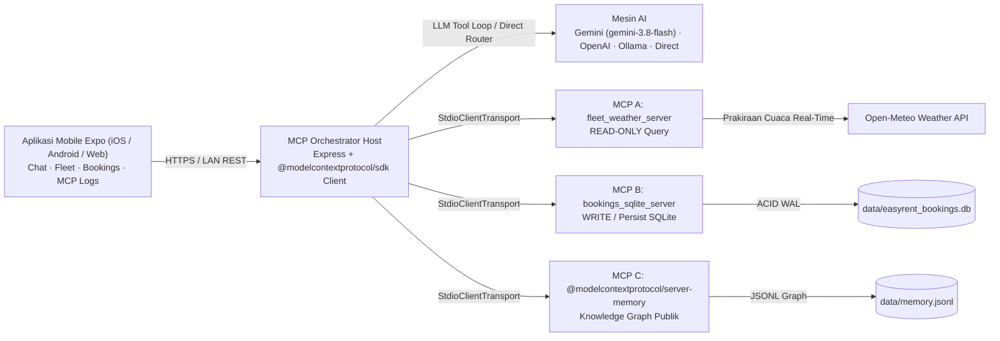

# Easy Rent Bali AI Concierge — Chatbot Mobile Expo dengan Integrasi Multi-MCP (Track A)

Aplikasi chatbot mobile berbasis **Expo (React Native + Expo Router)** untuk **Easy Rent Bali**, ditenagai oleh **3 server Model Context Protocol (`@modelcontextprotocol/sdk`) nyata** yang mendemonstrasikan alur dua arah secara penuh: **mengambil/query data langsung dari MCP A**, **mengubah/menyimpan data transaksi secara persisten ke MCP B (SQLite)**, serta **menyimpan memori preferensi pelanggan ke MCP C (Knowledge Graph MCP publik)**.

Desain UI/UX dibuat dengan **Google Stitch MCP** (*Obsidian Tropical AI Concierge*) dan dikembangkan secara end-to-end menggunakan **Google Antigravity**.

---

## Ringkasan Arsitektur



---

## Server MCP & Dokumentasi Resmi

Seluruh komunikasi MCP menggunakan **Model Context Protocol TypeScript SDK** resmi (`@modelcontextprotocol/sdk`) melalui `StdioClientTransport` (`client.connect`, `client.listTools`, `client.callTool`).

| Server | Peran | Arah Data | Tool yang Disediakan | Implementasi / Referensi Publik |
| --- | --- | --- | --- | --- |
| **MCP A** (`easy-rent-bali-mcp-a-fleet-weather`) | Katalog armada, perhitungan tarif dinamis IDR, hub penjemputan & cuaca Bali real-time | **READ / Query** | `search_fleet`, `get_vehicle_details`, `calculate_quote`, `get_bali_weather`, `get_hub_info` (serta resource `fleet://catalog`) | Server kustom `@modelcontextprotocol/sdk` (`apps/mcp-fleet-weather`) + [Open-Meteo API](https://open-meteo.com/) |
| **MCP B** (`easy-rent-bali-mcp-b-bookings-sqlite`) | Pencatatan reservasi transaksional yang tersimpan persisten di SQLite (`node:sqlite`) | **WRITE / Modify / Persist** | `create_booking`, `update_booking`, `cancel_booking`, `list_bookings`, `get_booking` (serta resource `bookings://ledger`) | Server kustom `@modelcontextprotocol/sdk` (`apps/mcp-bookings-sqlite`) |
| **MCP C** (`@modelcontextprotocol/server-memory`) | Knowledge Graph memori preferensi perjalanan pelanggan lintas sesi | **MEMORY / Persist** | `create_entities`, `add_observations`, `search_nodes`, `read_graph`, `create_relations` | MCP publik resmi: [@modelcontextprotocol/server-memory](https://github.com/modelcontextprotocol/servers/tree/main/src/memory) |

### Referensi Dokumentasi Publik Resmi
- **Model Context Protocol TypeScript SDK**: https://github.com/modelcontextprotocol/typescript-sdk
- **Official Memory MCP Server (`@modelcontextprotocol/server-memory`)**: https://github.com/modelcontextprotocol/servers/tree/main/src/memory
- **Open-Meteo Live Weather API**: https://open-meteo.com/en/docs

---

## Alur Dua Arah MCP (Query MCP A → Simpan ke MCP B)

1. **Pengguna mengirim pesan bahasa alami di Expo Chat**, contohnya:
   > *"Find me an automatic SUV in Canggu for 3 days starting tomorrow and book it for Maya"*
   *(atau dalam bahasa Indonesia, misalnya: "Cariin SUV matic di Canggu buat besok selama 3 hari atas nama Maya")*
2. **Query Data dari MCP A (`READ`)**:
   - Memanggil `mcp_a__get_bali_weather({ hub: "CANGGU" })` untuk mengambil kondisi cuaca & rekomendasi jalan terkini di Bali.
   - Memanggil `mcp_a__search_fleet({ category: "SUV", transmission: "Automatic", hub: "CANGGU" })` untuk mencari unit tersedia dan tarif harian (IDR).
   - Memanggil `mcp_a__calculate_quote({ vehicleId: "TOY-RAZ-04", days: 3, hub: "CANGGU" })` untuk menghitung rincian total biaya sewa.
3. **Ubah & Simpan ke MCP B (`WRITE`)**:
   - Memanggil `mcp_b__create_booking(...)` menggunakan data kendaraan & tarif dari **MCP A**, lalu menyimpannya secara persisten sebagai baris reservasi `ERB-2026-XXX` di database SQLite (`data/easyrent_bookings.db`).
4. **Simpan Memori Pelanggan di MCP C (`MEMORY`)**:
   - Memanggil `mcp_c__create_entities(...)` pada `@modelcontextprotocol/server-memory` agar preferensi kendaraan & lokasi Maya diingat antar-sesi.
5. **Mutasi Lanjutan (`update_booking` / `cancel_booking`)**:
   - Pengguna dapat mengganti lokasi hub penjemputan, memperpanjang durasi sewa, menambah surf rack, atau membatalkan booking lewat **Chat** maupun langsung dari tab **Pesanan** — setiap aksi langsung menjalankan mutasi SQLite pada **MCP B** dan tercatat di tab **Pengaturan** → **Inspektor & Log Teknis MCP**.

---

## Layar Aplikasi Mobile (`apps/mobile`)

Dirancang menggunakan **Google Stitch** (`docs/design/stitch_chat_screen.png` & `docs/design/stitch_bookings_screen.png`) dengan antarmuka **Bahasa Indonesia** yang ringkas dan responsif:

- **Chat**: Antarmuka asisten AI yang bersih, kartu **Cuaca Bali** interaktif dengan saran kendaraan, kartu **Pesanan** & **Armada**, tombol **Batal** + penghitung waktu proses, quick-prompt Bahasa Indonesia, serta bar **Detail Proses MCP** yang dapat dibuka untuk menginspeksi call MCP A / B / C beserta JSON & latensi `ms`.
- **Armada**: Kartu cuaca Bali real-time + filter lokasi jemput & kategori kendaraan dari **MCP A** dengan tombol **Pesan** instan dan **Tanya AI**.
- **Pesanan**: Daftar reservasi SQLite dari **MCP B** dengan aksi cepat **Lihat E-Tiket**, `+1 Hari`, `Ganti Lokasi`, dan `Batalkan`, serta catatan preferensi pelanggan dari **MCP C**.
- **Pengaturan**: Pengaturan sederhana profil & mode AI, akordeon **Atur API Key & Server Backend** (Gemini, OpenAI/OpenRouter/Groq, Ollama + tombol **Tes**), serta akordeon **Inspektor & Log Teknis MCP** (daftar 19 tool MCP dengan tombol **Uji** & riwayat JSON-RPC).

---

## Struktur Proyek

```text
easy-rent-bali-mcp-chatbot/
├── apps/
│   ├── mcp-fleet-weather/      # MCP Server A (READ: katalog armada, tarif, hub, Open-Meteo)
│   ├── mcp-bookings-sqlite/    # MCP Server B (WRITE: CRUD booking persisten via node:sqlite)
│   ├── orchestrator/           # Backend Express + Host Client 3x MCP + LLM Tool Loop / Direct Router
│   └── mobile/                 # Aplikasi Expo (React Native + Expo Router)
├── docs/design/                # Referensi mockup UI hasil Google Stitch
├── ai_session_logs/            # Ringkasan log sesi & steering audit AI coding agent
├── .env.example                # Contoh konfigurasi environment backend
├── render.yaml                 # Konfigurasi deploy Render
└── railway.toml                # Konfigurasi deploy Railway
```

---

## Prasyarat & Instalasi

- **Node.js >= 24.0.0** (menggunakan modul bawaan `node:sqlite` tanpa perlu kompilasi native C++)
- **npm >= 10**
- Opsional: **Gemini API Key** (Google AI Studio), **API Key kompatibel OpenAI** (OpenAI / OpenRouter / Groq), atau **Ollama** lokal (`ollama pull qwen2.5:3b`)

### 1. Instal Dependensi & Build Semua Server MCP

```bash
npm run install:all
npm run build:servers
```

### 2. Konfigurasi API Key & Provider LLM (Opsional)

Anda dapat mengatur API key melalui **salah satu** dari dua cara berikut:

**Opsi A — Melalui file `.env`** (otomatis dibaca dari `.env` di root proyek maupun `apps/orchestrator/.env`):

```bash
cp .env.example .env
```

Variabel utama pada `.env`:
- `PORT=3001`
- `LLM_ENGINE=auto`
- `GEMINI_API_KEY=...` dan `GEMINI_MODEL=gemini-3.8-flash`
- `OPENAI_API_KEY=...`, `OPENAI_BASE_URL=https://api.openai.com/v1`, `OPENAI_MODEL=gpt-4o-mini`
- `OLLAMA_BASE_URL=http://127.0.0.1:11434`, `OLLAMA_MODEL=qwen2.5:3b`, `OLLAMA_TIMEOUT_MS=120000`

**Opsi B — Langsung dari dalam UI Aplikasi Expo**:
Buka tab **Pengaturan** → buka **Atur API Key & Server Backend**, masukkan **Google Gemini API Key** / **OpenAI / Groq / OpenRouter API Key** / **Ollama Lokal**, tekan **Tes Gemini / Tes OpenAI / Tes Ollama** untuk verifikasi koneksi, lalu simpan dengan **Simpan Pengaturan**.

Mode `LLM_ENGINE` yang didukung:
- `auto` (default): Menggunakan `GEMINI_API_KEY` jika tersedia → jika tidak, `OPENAI_API_KEY` → jika tidak, `Ollama` lokal jika aktif → jika tidak, otomatis memakai router `direct`.
- `gemini`: Pemanggilan tool (`functionDeclarations`) menggunakan Google AI Studio Gemini (default `gemini-3.8-flash`, memakai `thinkingLevel: 'LOW'` pada seri `gemini-3*` agar respons cepat).
- `openai`: Pemanggilan tool untuk endpoint kompatibel OpenAI / OpenRouter / Groq.
- `ollama`: Pemanggilan tool lokal via Ollama `/api/chat` (`qwen2.5:3b`).
- `direct`: Router deterministik bahasa Indonesia/Inggris yang langsung mengeksekusi tool nyata **MCP A / B / C** (latensi LLM 0 ms, tetap berjalan penuh meski tanpa kuota API/GPU).

### 3. Jalankan Backend MCP Orchestrator

```bash
npm run start:orchestrator
```

Orchestrator berjalan pada `0.0.0.0:3001` sehingga perangkat fisik yang menjalankan **Expo Go** di jaringan Wi-Fi yang sama dapat langsung terhubung. Untuk mode pengembangan dengan auto-reload: `npm run dev:orchestrator`.

### 4. Jalankan Aplikasi Mobile Expo (QR Code & Pratinjau Web)

Pada terminal kedua:

```bash
npm run dev:mobile
```

- **HP Fisik (Expo Go)**: Scan **QR code** yang muncul di terminal menggunakan aplikasi **Expo Go** (Android) atau aplikasi Camera (iOS). Pastikan HP dan laptop berada di jaringan Wi-Fi yang sama (atau atur alamat server backend di tab **Pengaturan** → **Atur API Key & Server Backend** jika memakai URL publik).
- **Mode Tunnel** (untuk link pratinjau eksternal / beda jaringan Wi-Fi):
  ```bash
  cd apps/mobile && npx expo start --tunnel
  ```
- **Pratinjau Web (Browser)**:
  ```bash
  npm run dev:web
  ```

---

## Verifikasi Otomatis

Jalankan tes integrasi end-to-end 3 server MCP (menjalankan ketiga server stdio MCP nyata: query MCP A → simpan booking ke SQLite MCP B → update booking → cek persistensi lintas restart → pembatalan booking):

```bash
npm run test:mcp
```

Jalankan pengecekan tipe TypeScript untuk aplikasi mobile Expo:

```bash
cd apps/mobile && npx tsc --noEmit
```

---

## Deploy Cloud (Render / Railway)

File `render.yaml` dan `railway.toml` sudah tersedia di root repositori untuk men-deploy backend **MCP Orchestrator + MCP A/B/C**, lalu arahkan **Backend Orchestrator URL** pada tab **MCP Logs** di aplikasi Expo ke URL HTTPS hasil deploy tersebut.

---

## Audit Sesi AI (AI-First Policy)

Sesuai ketentuan **Mandatory AI-First Policy** pada Technical Assessment, dokumentasi proses pengembangan, iterasi prompt, desain Google Stitch, dan penyelesaian masalah teknis tersimpan di:
- [ai_session_logs/SESSION_SUMMARY.md](ai_session_logs/SESSION_SUMMARY.md)
